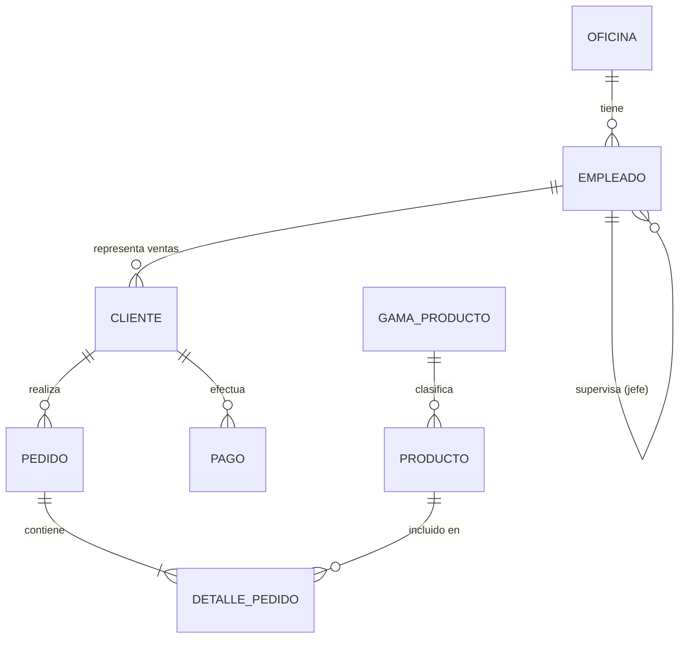

# Especificación de Requerimientos de Software (SRS) — Sistema de Gestión de Jardinería

## 1. Descripción General del Proyecto

El presente documento define los requerimientos funcionales, no funcionales, arquitectónicos y de flujo de trabajo para el desarrollo del sistema de información **Jardinería**. El objetivo es construir una aplicación robusta, escalable y mantenible en Java (Maven) conectada a una base de datos MySQL en contenedor Docker, aplicando **Arquitectura Hexagonal**, **principios SOLID**, **patrones de diseño** y una **interfaz gráfica profesional con Dashboard**.

---

## 2. Stack Tecnológico e Infraestructura

### 2.1 Configuración del Proyecto (`pom.xml`)

* **Gestor de dependencias y construcción:** Apache Maven.
* **Lenguaje:** Java (JDK 17 o superior recomendado).
* **Dependencias principales:**
  * Conector JDBC oficial de MySQL (`mysql-connector-j`).
  * Librería de interfaz gráfica moderna (ej. `JavaFX` o `Swing` + `FlatLaf` para apariencia profesional).
  * Librería de gráficos/estadísticas para el Dashboard (ej. `JFreeChart` o controles nativos de `JavaFX`).
  * *Mejora recomendada:* `Lombok` para reducir código repetitivo, `SLF4J` + `Logback` para trazabilidad de logs y `JUnit 5` para pruebas unitarias.

### 2.2 Base de Datos y Contenedorización

* **Motor de Base de Datos:** MySQL (versión 8.x).
* **Entorno de ejecución:** Contenedor Docker (`mysql` oficial o `MySQLContainer` mediante Docker / Docker Compose).
* **Gestión de conexión:** Archivo externo de propiedades (`application.properties` o `db.properties`) cargado mediante el **Patrón Singleton** para centralizar y reutilizar la instancia de conexión JDBC.

---

## 3. Arquitectura y Principios de Diseño

El sistema se estructurará bajo **Arquitectura Hexagonal (Puertos y Adaptadores)** respetando estrictamente los **principios SOLID**:

1. **Capa de Dominio (`domain`):**
   * Contiene las entidades puras del negocio (`model`), reglas de negocio, excepciones de dominio y los **Puertos de Salida (`ports.out`)** que definen los contratos de persistencia (interfaces de repositorio).
   * *Independencia:* No depende de frameworks, librerías de UI ni detalles de SQL.
2. **Capa de Aplicación (`application`):**
   * Contiene los **Puertos de Entrada (`ports.in`)** y los **Casos de Uso / Servicios (`usecases` / `services`)** que orquestan la lógica de negocio.
3. **Capa de Infraestructura (`infrastructure`):**
   * **Adaptadores de Salida (`adapters.out.persistence`):** Implementaciones concretas de los repositorios utilizando JDBC y MySQL, además de la clase de configuración con **Patrón Singleton**.
   * **Adaptadores de Entrada (`adapters.in.ui`):** Interfaz gráfica de usuario (Dashboard, menús, submenús y formularios).

### 3.1 Patrones de Diseño Aplicados

* **Singleton:** Para la clase `DatabaseConfig` / `ConnectionManager` encargada de gestionar la configuración y conexión única a MySQL.
* **Repository:** Para abstraer el acceso a datos mediante interfaces en el dominio e implementaciones JDBC en infraestructura.
* **Builder / Factory (Mejora recomendada):** Para la construcción limpia de entidades complejas y objetos de respuesta.
* **DTO (Data Transfer Object) (Mejora recomendada):** Para desacoplar las entidades del dominio de los datos mostrados en las vistas y tablas de la interfaz gráfica.

---

## 4. Modelo de Dominio y Relaciones (UML)

El sistema debe contar con un mínimo de **8 entidades de dominio** debidamente modeladas, encapsuladas y relacionadas entre sí.

### 4.1 Entidades del Dominio

| #    | Entidad             | Descripción                                                  | Atributos Principales Sugeridos                              |
| :--- | :------------------ | :----------------------------------------------------------- | :----------------------------------------------------------- |
| 1    | **`Oficina`**       | Sedes o sucursales físicas de la empresa.                    | `codigoOficina` (PK), `ciudad`, `pais`, `region`, `codigoPostal`, `telefono`, `lineaDireccion1`, `lineaDireccion2` |
| 2    | **`Empleado`**      | Personal que labora en las oficinas y atiende clientes.      | `codigoEmpleado` (PK), `nombre`, `apellido1`, `apellido2`, `extension`, `email`, `codigoOficina` (FK), `codigoJefe` (FK recursiva), `puesto` |
| 3    | **`Cliente`**       | Compradores registrados y asignados a un representante de ventas. | `codigoCliente` (PK), `nombreCliente`, `nombreContacto`, `apellidoContacto`, `telefono`, `fax`, `lineaDireccion1`, `ciudad`, `pais`, `codigoEmpleadoRepVentas` (FK), `limiteCredito` |
| 4    | **`GamaProducto`**  | Categorías o líneas de productos de jardinería.              | `gama` (PK), `descripcionTexto`, `descripcionHtml`, `imagen` |
| 5    | **`Producto`**      | Artículos disponibles en el catálogo e inventario.           | `codigoProducto` (PK), `nombre`, `gama` (FK), `dimensiones`, `proveedor`, `descripcion`, `cantidadEnStock`, `precioVenta`, `precioProveedor` |
| 6    | **`Pedido`**        | Órdenes de compra realizadas por los clientes.               | `codigoPedido` (PK), `fechaPedido`, `fechaEsperada`, `fechaEntrega`, `estado`, `comentarios`, `codigoCliente` (FK) |
| 7    | **`DetallePedido`** | Líneas de detalle de productos incluidos en cada pedido.     | `codigoPedido` (PK, FK), `codigoProducto` (PK, FK), `cantidad`, `precioUnidad`, `numeroLinea` |
| 8    | **`Pago`**          | Transacciones financieras registradas por cliente.           | `codigoCliente` (PK, FK), `formaPago`, `idTransaccion` (PK), `fechaPago`, `total` |

### 4.2 Diagrama de Relaciones UML (Mermaid)

### 4.3 Cardinalidades Clave

* **Oficina — Empleado (`1 : N`):** Una oficina tiene muchos empleados; un empleado pertenece a una oficina.
* **Empleado — Empleado (`1 : N`):** Relación reflexiva donde un empleado (jefe) supervisa a cero o muchos empleados.
* **Empleado — Cliente (`1 : N`):** Un empleado (representante de ventas) gestiona múltiples clientes.
* **Cliente — Pedido (`1 : N`):** Un cliente puede realizar múltiples pedidos.
* **Cliente — Pago (`1 : N`):** Un cliente puede registrar múltiples pagos.
* **Pedido — DetallePedido (`1 : N`):** Un pedido se compone de una o más líneas de detalle.
* **Producto — DetallePedido (`1 : N`):** Un producto puede aparecer en múltiples detalles de pedidos.
* **GamaProducto — Producto (`1 : N`):** Una gama agrupa múltiples productos.

---

## 5. Requerimientos Funcionales y Contratos CRUD

### 5.1 Contratos de Repositorio (Mínimo 8 Repositorios)

Por cada una de las 8 entidades se debe definir su **interfaz de repositorio (Puerto de Salida)** y su **implementación JDBC (Adaptador)** garantizando como mínimo las siguientes operaciones base:

* **`guardar(T entidad)` / `save`:** Inserta un nuevo registro en la base de datos validando integridad referencial.
* **`listarTodos()` / `findAll`:** Recupera la colección completa de registros existentes.
* **`buscarPorId(ID id)` / `findById`:** Consulta y retorna un registro específico (preferiblemente envuelto en `Optional<T>`).
* **`actualizar(T entidad)` / `update`:** Modifica los datos de un registro existente identificado por su llave primaria.

### 5.2 Mejoras Funcionales Recomendadas

* **Eliminación controlada (`eliminarPorId` / `deleteById`):** Borrado físico o lógico verificando previamente que no existan dependencias activas (llaves foráneas).
* **Búsquedas filtradas:** Consultas específicas del negocio (ej. productos con bajo stock, pedidos por estado, pagos por rango de fechas, empleados por oficina).
* **Validaciones de negocio:** Verificación de stock disponible antes de registrar un `DetallePedido`, validación de límite de crédito en `Cliente` y manejo de transacciones SQL (`commit` / `rollback`) en operaciones compuestas (como crear un Pedido junto con sus Detalles).

---

## 6. Interfaz Gráfica de Usuario (UI/UX) y Dashboard

Se desarrollará una **interfaz gráfica de escritorio profesional, intuitiva y responsiva** que reemplace las consolas tradicionales, estructurada de la siguiente manera:

### 6.1 Estructura de Navegación

* **Barra Lateral / Menú Principal:** Acceso directo a los módulos principales:
  1. **Dashboard (Inicio)**
  2. **Gestión Comercial** (Clientes, Pedidos, Detalles de Pedido, Pagos)
  3. **Catálogo e Inventario** (Productos, Gamas de Producto)
  4. **Estructura Organizacional** (Oficinas, Empleados)
* **Submenús Operativos por Módulo:** Cada sección contará con vistas organizadas con pestañas o paneles para:
  * **Listado y Búsqueda:** Tabla interactiva con barra de búsqueda en tiempo real y filtros.
  * **Registro y Edición:** Formularios limpios con validación de campos, selectores desplegables (`ComboBox`) para llaves foráneas y mensajes de confirmación o error claros.

### 6.2 Panel Principal (Dashboard)

La pantalla inicial mostrará un resumen ejecutivo en tiempo real del estado de la jardinería:

* **Tarjetas de KPIs (Indicadores Clave):** Total de ingresos recaudados, cantidad de pedidos pendientes/entregados, total de clientes activos y alertas de productos con stock crítico.
* **Visualizaciones Gráficas:** Gráfico de barras o pastel con ventas por gama de producto o estado de pedidos, y tabla rápida con los últimos pedidos registrados.

---

## 7. Control de Versiones y Flujo de Trabajo con Git

El desarrollo del proyecto se gestionará estrictamente mediante **Git** y un repositorio remoto (GitHub / GitLab), siguiendo estas reglas:

### 7.1 Estrategia de Ramas (Git Flow)

* **Rama principal de integración (por defecto):** `develop`. Toda integración de nuevas funcionalidades debe apuntar a esta rama.
* **Rama de producción:** `main` (opcional para entregas estables finales).
* **Ramas de funcionalidades:** `feature/<nombre-funcionalidad>` creadas a partir de `develop` (ej. `feature/configuracion-maven-docker`, `feature/dominio-entidades`, `feature/repositorios-crud`, `feature/ui-dashboard`).

### 7.2 Estándar de Commits (Conventional Commits + Gitmojis)

Todos los commits deben seguir el formato `<emoji> <tipo>(<alcance>): <descripción breve en imperativo>`:

* **Commit inicial obligatorio:**
  * `:tada:` (`🎉`) — `🎉 chore(init): inicializar estructura del proyecto jardineria`
* **Convenciones para el resto del desarrollo:**
  * `✨ feat(<alcance>):` Nueva funcionalidad o entidad agregada.
  * `🐛 fix(<alcance>):` Corrección de errores o fallos de conexión/SQL.
  * `♻️ refactor(<alcance>):` Refactorización de código aplicando SOLID o patrones de diseño.
  * `🏗️ build(<alcance>):` Configuración de `pom.xml`, Docker o dependencias.
  * `🎨 style(<alcance>):` Mejoras visuales en la interfaz gráfica y Dashboard.
  * `📝 docs(<alcance>):` Actualización de documentación, diagramas UML o `README.md`.

---

## 8. Planificación y Fases de Ejecución

1. **Fase 1 — Inicialización y Entorno:**
   * Inicializar repositorio Git con rama por defecto `develop` y realizar primer commit `:tada:`.
   * Configurar `pom.xml`, levantar contenedor Docker con MySQL y crear el esquema de base de datos.
   * Implementar `DatabaseConfig` bajo el **Patrón Singleton**.
2. **Fase 2 — Capa de Dominio:**
   * Crear las 8+ entidades con sus relaciones y validaciones.
   * Definir las 8+ interfaces de repositorio (Puertos de Salida) con el contrato CRUD.
3. **Fase 3 — Infraestructura y Persistencia:**
   * Implementar los repositorios JDBC para cada entidad y probar operaciones CRUD contra MySQL.
4. **Fase 4 — Capa de Aplicación:**
   * Desarrollar los casos de uso / servicios conectando puertos de entrada y salida.
5. **Fase 5 — Interfaz Gráfica y Dashboard:**
   * Construir la ventana principal, menú de navegación, submenús CRUD por entidad y el Dashboard estadístico.
6. **Fase 6 — Integración Final y Documentación:**
   * Realizar pruebas integrales de extremo a extremo, mergear ramas `feature/*` hacia `develop` y documentar instrucciones de despliegue en el `README.md`.